<div align="center">

<picture>
  <source media="(prefers-color-scheme: dark)" srcset=".github/assets/banner-dark.svg">
  
</picture>

**Offline-first data at native speed.**<br>
Typed PHP models on the PAM Native SQLite module: lazy, indexed, paginated queries, one-call batches and a durable sync outbox.

[](https://packagist.org/packages/pushinbr/pam-native-nitro)

[](https://github.com/push-in/pam-native-nitro/actions/workflows/ci.yml)
[](LICENSE)

[Install](#install) · [Quick example](#quick-example) · [Platforms](#platform-support) · [Compatibility](#compatibility) · [Docs](#docs) · [Issues](https://github.com/push-in/pam-native-nitro/issues)

</div>

<a id="install"></a>
## <picture></picture> Install

Inside a PAM Native project:

```sh
pam composer require pushinbr/pam-native-nitro
```

Nitro is plain PHP on top of the PAM Native core `SQLite` module: no plugin descriptor, no native code of its own, no permissions, no Info.plist keys and nothing to add to `pam-native.json`. Databases live in the app's private storage. It requires `pushinbr/pam-native` `^0.8 || ^0.9 || ^0.10 || ^1.0` and PHP 8.5.

New to PAM? Create a project with `pam init my-app --template native` and run it with `pam mobile dev` (see the [PAM Native overview](https://push-in.github.io/pam-docs/native/overview/)), then come back here. Composer owns the manifest and the lockfile; `pam composer` runs it on PAM's verified PHP runtime. Remove it with `pam composer remove pushinbr/pam-native-nitro`.

<a id="quick-example"></a>
## <picture></picture> Quick example

```php
<?php

use Pam\Nitro\Attributes\Field;
use Pam\Nitro\Attributes\PrimaryKey;
use Pam\Nitro\Batch;
use Pam\Nitro\Model;
use Pam\Nitro\Nitro;

enum MessageType: int
{
    case Text = 1;
    case Image = 2;
}

final class Message extends Model
{
    #[PrimaryKey]
    #[Field]
    public string $id;

    #[Field(indexed: true)]
    public string $chatId;

    #[Field]
    public string $body;

    #[Field]
    public MessageType $type;

    #[Field(indexed: true)]
    public int $createdAt;

    public static function table(): string
    {
        return 'messages';
    }
}

Nitro::boot('zechat.db');
Nitro::prepare([Message::class], function () use ($chatId): void {
    Message::query()
        ->where('chat_id', $chatId)
        ->latest()
        ->limit(20)
        ->get(function (array $messages): void {
            $this->messages = array_reverse($messages);
        });
});

// Many heterogeneous writes: one native call, one transaction.
Nitro::batch(function (Batch $batch) use ($chat, $messages, $draft): void {
    $batch->save($chat)
        ->saveMany($messages)
        ->delete($draft);
}, function (): void {
    // Committed atomically.
});
```

Every native call is asynchronous and returns the module request id. Failures go to a `$failure` callback or `Nitro::onFailure()`; they are never thrown from native callbacks. Relations, `fetch()`, `replaceMany()`, the sync outbox, schema evolution and a real-app store are in the [guide](docs/guide.md).

<a id="platform-support"></a>
## <picture></picture> Platform support

| Platform | Support | Notes |
| --- | --- | --- |
| Android | API 26+ (Android 8) | Native SQLite through the PAM Native core module |
| iOS | 15.0+ | Prepared statements reused natively with PAM Native 1.9.1+ |
| PAM Native | `^0.8 \|\| ^0.9 \|\| ^0.10 \|\| ^1.0` | From `composer.json`; PHP 8.5+ |

<a id="design"></a>
## <picture></picture> Design

- Native SQLite on Android and iOS.
- WAL, `synchronous=NORMAL` and prepared-statement reuse in the PAM runtime.
- One native round-trip per boot to verify the schema fingerprint.
- `Nitro::batch()` and `Nitro::fetch()` for one-call writes and reads.
- Payloads stay under a 768 KiB budget, below the original one-MiB PAM Native
  bridge limit (PAM Native 1.10 raised it to 32 MiB; Nitro keeps the small
  budget so it works on every supported core): large writes are staged and
  committed atomically, large results are paged.
- Lazy models: no full-database hydration.
- Bounded, indexed, paginated queries.
- Integer-backed enums for coded domain values.
- Additive schema evolution without dropping cached rows.
- Atomic scoped snapshot replacement without stale rows or empty-cache windows.
- Durable idempotent mutation outbox with bounded exponential retry.
- Integer-backed mutation states, operations and conflict policies.
- No reflection in hot query paths; schemas are reflected once and cached.
- No JavaScript, JSI, ORM proxies, or runtime code generation.

WatermelonDB demonstrated the right mobile principle: keep queries native,
lazy, asynchronous, and observable. PAM Native Nitro applies that principle to PAM's
persistent PHP runtime with fewer transport layers.

Read the [architecture](docs/architecture.md) and
[benchmark protocol](docs/benchmarks.md) before evaluating performance claims.

PAM Native Nitro 0.5 supports PAM Native 0.8 through 1.x on PHP 8.5,
Android 8 (API 26) or newer and iOS 15 or newer.

<a id="compatibility"></a>
## <picture></picture> Compatibility

| `pushinbr/pam-native-nitro` | `pushinbr/pam-native` | Notes |
| --- | --- | --- |
| 0.5.2 | `^0.8 \|\| ^0.9 \|\| ^0.10 \|\| ^1.0` (tested with 1.14.x) | iOS reuses prepared statements with PAM Native 1.9.1+ |
| 0.5.1 | same | Bridge-size-safe writes and paged reads, `$failure` callbacks |
| 0.5.0 | same | Android API 26+, iOS 15+ |

<a id="troubleshooting"></a>
## <picture></picture> Troubleshooting

- **"Call Nitro::boot() before querying models":** boot once at startup (or in a single owner like Zé Chat's `NitroStore`, see the [guide](docs/guide.md#a-real-example-zé-chat)).
- **A new property breaks old rows:** give non-nullable properties a default; renames and type changes need an explicit migration.
- **Nothing happens and no error is shown:** register `Nitro::onFailure()` or pass `$failure`; failures are never thrown from native callbacks.
- **Queries return at most 1000 rows:** `limit()` is clamped; page with `orderBy()` and a `where()` on the last key.

<a id="tests-and-status"></a>
## <picture></picture> Tests and status

`pam composer test` runs the PHPUnit suite against a SQLite transport (`tests/Support/SqliteTransport.php`), including bridge-limit, batch, schema-reconciliation and sync-queue tests. `pam composer benchmark` runs `benchmarks/cache.php`.

Performance claims follow the [benchmark protocol](docs/benchmarks.md): physical devices, median and p95, exact commit. A 10x gain over full JSON-cache hydration is an engineering target, not a measured result; Nitro does not claim to be faster than WatermelonDB until the cross-framework device suite shows it.

PAM Native Nitro is under active development. The initial API is intentionally small while the binary bridge, batch writes, observation, destructive migrations, relations, and benchmarks are hardened.

<a id="docs"></a>
## <picture></picture> Docs

- [Guide: models, queries, sync, schema evolution, Zé Chat example](docs/guide.md)
- [API reference](docs/api-reference.md)
- [Architecture](docs/architecture.md)
- [Benchmark protocol](docs/benchmarks.md)
- [Example app (offline notes)](example/)
- [Package guide on pam-docs](https://push-in.github.io/pam-docs/packages/native-nitro/)
- [PAM Native overview](https://push-in.github.io/pam-docs/native/overview/)
- [Plugin and native capability model](https://push-in.github.io/pam-docs/native/plugins/)
- [Changelog](CHANGELOG.md)
- [Report an issue](https://github.com/push-in/pam-native-nitro/issues)

<a id="pam-ecosystem"></a>
## <picture></picture> Part of the PAM ecosystem

<p align="center"><picture>
  <source media="(prefers-color-scheme: dark)" srcset=".github/assets/pam-wordmark-dark.svg">
  
</picture></p>

PAM runs PHP natively on servers, desktops and phones. This repository is one piece of it.

| [**PAM**](https://github.com/push-in/pam) | [**PAM Desktop**](https://github.com/push-in/pam-desktop) | [**PAM Native**](https://github.com/push-in/pam-native) | [**Ecosystem**](https://github.com/push-in/pam#ecosystem) |
| --- | --- | --- | --- |
| the runtime and CLI | native desktop apps in PHP | native Android and iOS apps in PHP | every official package and plugin |

<sub>Docs: [push-in.github.io/pam-docs](https://push-in.github.io/pam-docs/introduction/) · [Issues](https://github.com/push-in/pam-native-nitro/issues)</sub>

<p align="center"><sub><a href="LICENSE.md">Apache License 2.0</a> · Made in Brazil by Pushin</sub></p>
